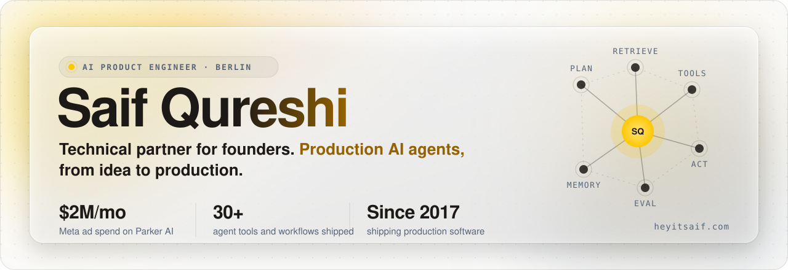

<a href="https://heyitsaif.com">
  <picture>
    <source media="(prefers-color-scheme: dark)" srcset="assets/header-dark.svg">
    
  </picture>
</a>

### I help founders without a CTO turn an idea into a product that runs in production.

Founding AI product engineer at **Parker AI** · Founder of **[SolutionPlus](https://solutionplus.io)** · Builder of **[QuickBilling](https://quickbilling.io)**

   

## Three ways to work with me

| | **Founders** | **Companies and teams** | **Freelancers and small businesses** |
|---|---|---|---|
| **You need** | A senior technical partner, without hiring a full-time CTO | Senior AI engineering for an agent, RAG or SaaS build | Quotes and invoices without a heavy accounting tool |
| **You get** | A scope from one free call, then slices of 2 to 12 weeks. Each slice ends with something running that you can click, test and show. | Fixed-scope builds and extra team capacity through my studio, SolutionPlus | QuickBilling, the invoicing SaaS I built and run myself |
| **Start here** | [For founders](https://heyitsaif.com/for-founders) | [solutionplus.io](https://solutionplus.io) | [quickbilling.io](https://quickbilling.io) |

I take one or two builds at a time, so your product gets my days, not my leftover hours.

## Shipped, and still running

| Product | What I built | Result |
|---|---|---|
| **[Parker AI](https://heyitsaif.com/projects/parker-ai)** | Founding engineer since June 2023. A multi-agent platform on Mastra and Temporal that turns TikTok, Instagram and Meta signal into creative briefs for DTC brands. | Brands spending up to **$2M a month** on Meta ads. Idea turnaround went from **days to minutes**. |
| **[Bewerbung.AI](https://heyitsaif.com/projects/bewerbung-ai)** | The résumé editor plus the cover-letter and job-fit agents for a German hiring-market SaaS (2023 to 2024). | Time to a finished application dropped from **hours to minutes**. |
| **[QuickBilling](https://heyitsaif.com/projects/quickbilling)** | An invoicing and expense SaaS, built alone from zero to production: quotes, invoices, share links with tracking, expenses, workspaces. | Live, with docs and a public **OpenAPI**. |
| **[getSimplePay](https://heyitsaif.com/projects/getsimplepay)** | Lead engineer (2022 to 2024): the Shopify app and checkout extensions for a US bank-pay (ACH) product. | Merchants offer bank pay at checkout with **no custom theme work**. |

The full case studies, with architecture and stack, are at [heyitsaif.com/projects](https://heyitsaif.com/projects). The founder story behind Parker AI: [from an idea to a platform](https://heyitsaif.com/stories/parker-ai).

## Open source

- **[MySearch](https://github.com/HeyitSaif/mysearch)**: a private search engine for your own folders that runs entirely on a Mac. Meaning and keyword search over documents, scans, e-mail, audio and video, English questions that find German documents, and MCP so AI agents can search too. Built on EmbeddingGemma 2 and MLX. [How I built it](https://heyitsaif.com/blog/embeddinggemma-2-local-search).
- **[Clippy](https://github.com/HeyitSaif/Clippy)** : a clipboard manager for macOS, Windows and Linux. History, search and pins stay on your machine in a local SQLite database.

## How a build runs

1. **A free 30-minute call.** You walk me through the idea. I tell you what I would build first and what I would cut.
2. **A scoped milestone.** 2 to 12 weeks, with clear deliverables, a shared definition of done and the evals that prove it.
3. **Built for production.** Typed and traced tool calls, evals on every model change, cost and latency dashboards, human checkpoints on risky actions.
4. **A handoff your team can run.** Runbooks, dashboards and docs, so your engineers can operate and extend what we shipped.

## Writing

Notes from building production AI, at [heyitsaif.com/blog](https://heyitsaif.com/blog):

- [EmbeddingGemma 2 local search: building Finer on a local embeddings API](https://heyitsaif.com/blog/embeddinggemma-2-local-search)
- [Build local hybrid search with SQLite FTS5, EmbeddingGemma 2 and Python](https://heyitsaif.com/blog/hybrid-search-sqlite-fts5-python)
- [Will AI replace motion designers? Motion graphics are code now](https://heyitsaif.com/blog/will-ai-replace-motion-designers)
- [Claude Motion and Higgsfield Katana, explained](https://heyitsaif.com/blog/claude-motion-higgsfield-katana)

> **Demos are cheap. Production is the product.** The other five lines of my production-AI thesis are on [the home page](https://heyitsaif.com/#thesis).

## Stack

**Agents and models** Mastra · Temporal · MCP tools · Langfuse · OpenAI · Anthropic · Gemini 
**Retrieval and data** Qdrant · Supabase Postgres · Redis · MongoDB · SQLite FTS5 
**Product** TypeScript · React · Next.js · Node.js · React Native 
**Infrastructure** GCP · AWS · Cloudflare Workers · Vercel · Docker

## Contact

Berlin, working remotely worldwide. The EU time zone overlaps Europe, the UK and the US East Coast. 
[Book a free 30-minute call](https://calendly.com/heyitsaif) · [isaifqureshi@gmail.com](mailto:isaifqureshi@gmail.com) · [LinkedIn](https://linkedin.com/in/HeyitSaif)

I usually reply within one business day.
